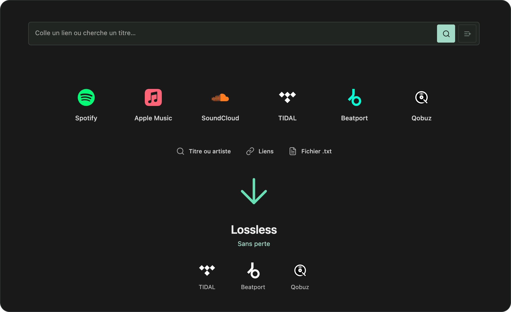

<p align="center">
  
</p>

<h1 align="center">TuneSaver</h1>

<p align="center">
  Une application Mac, une commande terminal et une interface web<br>
  pour télécharger, écouter et organiser sa musique.
</p>

<p align="center">
  <a href="https://github.com/galagain/tunesaver/releases/tag/v0.4.0"></a>
  
  
</p>

<p align="center">
  <a href="https://github.com/galagain/tunesaver/releases/tag/v0.4.0"><strong>Télécharger</strong></a> ·
  <a href="https://tunesaver.galagain.com">Ouvrir le web</a> ·
  <a href="#démarrer">Installation</a> ·
  <a href="#documentation">Documentation</a>
</p>

---

## Une bibliothèque, plusieurs façons de l’utiliser

- **Télécharger** depuis TIDAL, Beatport et Qobuz avec ses comptes connectés.
- **Importer des playlists** et retrouver leurs titres sur les plateformes disponibles.
- **Écouter et organiser** ses morceaux dans une bibliothèque avec playlists et tags.
- **Connecter un appareil depuis le web**, sans recopier les fichiers des comptes.
- **Synchroniser le catalogue** : titres, artistes, plateformes et liens. Les audios restent sur leur machine.

<p align="center">
  
</p>

Les liens et playlists servent à retrouver les titres sur **TIDAL, Beatport ou
Qobuz**. La disponibilité et la qualité audio dépendent du catalogue, de votre
abonnement et des réglages de téléchargement.

## Démarrer

| Vous souhaitez… | Choisissez… | Première étape |
| --- | --- | --- |
| Une application sur votre Mac | **Mac** | Installer l’application, puis ouvrir **Mes plateformes** |
| Télécharger depuis le terminal | **CLI Mac** | Installer la commande depuis le menu TuneSaver |
| Utiliser le service en ligne | **Web** | [Ouvrir TuneSaver](https://tunesaver.galagain.com) avec un compte approuvé |
| Héberger votre propre instance | **Docker** | Lancer `./tunesaver server setup` dans le dépôt |

### Mac

1. Télécharger le [DMG 0.4.0](https://github.com/galagain/tunesaver/releases/download/v0.4.0/TuneSaver-0.4.0-macOS-arm64.dmg).
2. Glisser **TuneSaver** dans **Applications**.
3. Ouvrir **Mes plateformes** et connecter son compte TIDAL, Beatport ou Qobuz.

Les connexions individuelles utilisent vos propres comptes, directement auprès des
plateformes : aucun compte sur le serveur TuneSaver n’est nécessaire.

Le bouton **Se connecter avec TuneSaver** propose un autre parcours : importer les
connexions mises à disposition par le serveur. Il nécessite un compte TuneSaver
approuvé et une confirmation du code affiché dans le navigateur.

> Le paquet actuel cible **Apple Silicon et macOS 26 ou plus récent**. Il est signé
> localement, mais **pas encore notarié par Apple** ; macOS peut bloquer son ouverture.
> Voir le [guide Mac](docs/macos.md) pour les détails de distribution.

### Terminal

Dans l’application : **TuneSaver → Installer la commande tunesaver…**, puis ouvrir
un nouveau terminal. Python et les outils audio sont inclus ; aucun Docker ni
Homebrew n’est nécessaire pour utiliser le client Mac.

Pour connecter votre propre compte, précisez la plateforme :

```sh
tunesaver login tidal
tunesaver login beatport
tunesaver login qobuz
```

Connectez seulement les plateformes que vous utilisez :

- **TIDAL** : autorisez la connexion depuis le lien affiché dans le terminal.
- **Beatport** : saisissez votre identifiant et votre mot de passe.
- **Qobuz** : saisissez votre identifiant numérique et votre jeton de session ; le terminal indique où les récupérer.

Puis téléchargez un morceau, un album ou une playlist :

```sh
tunesaver "https://tidal.com/track/123"
```

Le Mac et le terminal partagent leurs comptes dans le Trousseau. Si vous êtes déjà
connecté dans l’application, passez directement au téléchargement.

#### Importer les comptes depuis le serveur

```sh
tunesaver login
```

**Sans nom de plateforme**, cette commande ouvre `tunesaver.galagain.com` et
importe les connexions autorisées par ce serveur. Elle nécessite un compte
TuneSaver approuvé. Ce parcours est facultatif sur Mac : les commandes
`login tidal`, `login beatport` et `login qobuz` connectent vos propres comptes.

#### Déconnecter ou changer de compte

```sh
tunesaver logout tidal
tunesaver logout beatport
tunesaver logout qobuz
```

Chaque commande retire la connexion de la plateforme concernée sur ce Mac,
pour **l’application et le terminal**. Les morceaux téléchargés sont conservés.
Pour utiliser un autre compte, déconnectez le compte actuel puis reconnectez-vous :

```sh
tunesaver logout beatport
tunesaver login beatport
```

La synchronisation du catalogue est indépendante des connexions musicales.
**Déconnecter les plateformes ou connecter ses propres comptes ne désactive pas
une synchronisation déjà configurée avec le serveur.**

#### Commandes utiles

```sh
tunesaver                            # Recherche interactive
tunesaver search "artiste titre"      # Rechercher un morceau
tunesaver status                     # Vérifier les comptes
tunesaver sync                       # Synchroniser si un serveur est configuré
```

Les téléchargements vont dans `~/Music/TuneSaver`. Pour choisir un dossier :

```sh
tunesaver download "https://tidal.com/track/123" -o "$HOME/Music/Mon set"
```

<details>
<summary><strong>Installer uniquement le terminal</strong></summary>

Télécharger l’[archive CLI](https://github.com/galagain/tunesaver/releases/download/v0.4.0/TuneSaver-0.4.0-macOS-arm64-CLI.tar.gz), puis :

```sh
tar -xzf TuneSaver-0.4.0-macOS-arm64-CLI.tar.gz
./TuneSaverCLI/tunesaver install --configure-shell
```

Ouvrir un nouveau terminal, puis lancer par exemple `tunesaver login tidal`
pour connecter son propre compte.
Pour Linux, utiliser le déploiement Docker ci-dessous.

</details>

### Serveur Docker

**Prérequis :** Git, Python 3 et Docker avec Compose v2.

```sh
git clone https://github.com/galagain/tunesaver.git
cd tunesaver
./tunesaver server setup
```

Ce parcours de configuration Docker utilise actuellement la connexion web à
`tunesaver.galagain.com` pour importer les comptes autorisés. Les commandes de
connexion et déconnexion individuelles décrites ci-dessus concernent le client Mac.

La configuration prépare les dossiers, crée le mot de passe administrateur,
connecte les plateformes et démarre les services disponibles. L’interface est
accessible sur **<http://127.0.0.1:8080>**.

Sur une machine sans navigateur, ouvrez le lien de connexion depuis un autre
appareil et confirmez le code. SQLite fonctionne par défaut ; un
[PostgreSQL autonome](docs/postgres.md) est disponible en option.

```sh
./tunesaver server status
./tunesaver server logs
./tunesaver server stop
```

Pour publier le site, configurer le domaine et un proxy HTTPS. L’inscription et la
récupération par e-mail nécessitent SMTP. Le [guide serveur](docs/server.md)
détaille la configuration, les mises à jour et le stockage.

## Comptes et données

| Élément | Fonctionnement |
| --- | --- |
| Comptes des plateformes | Trousseau sur Mac ; fichiers privés côté serveur |
| Connexion depuis le web | Compte approuvé, confirmation du code et autorisation à usage unique |
| Catalogue global | Métadonnées uniquement : titres, artistes, plateformes et liens |
| Audio | Conservé sur la machine de téléchargement ; aucun transfert par la synchronisation du catalogue |
| Conservation | Le Mac conserve les audios ; le serveur web applique une expiration de sept jours par défaut |

L’approbation d’un utilisateur sur le serveur lui permet de récupérer les
connexions des plateformes proposées par ce serveur. Les abonnements et droits
d’accès des plateformes restent nécessaires.

Les secrets, fichiers audio et bases locales ne sont pas versionnés. Sauvegardez
vos données et configurations avant une mise à jour.

## Documentation

| Guide | Contenu |
| --- | --- |
| [Mac et terminal](docs/macos.md) | Installation, construction et données locales |
| [Serveur Docker](docs/server.md) | Configuration, commandes et exploitation |
| [PostgreSQL](docs/postgres.md) | Base autonome, migration et sauvegardes |
| [Connexion des appareils](docs/account-transfer.md) | Autorisation web et import manuel |
| [Catalogue global](docs/catalog-sync.md) | Synchronisation des métadonnées |
| [Architecture](docs/architecture.md) | Moteur partagé, interfaces et déploiement |
| [Rétention audio](docs/audio-retention.md) | Conservation et nettoyage des fichiers |

---

<p align="center">
  <br>
  <sub>Une seule commande : <code>tunesaver</code>.</sub>
</p>
